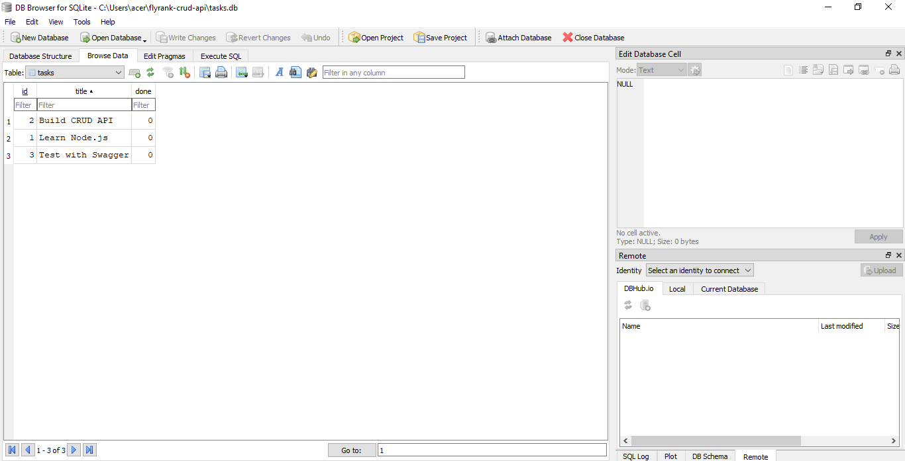
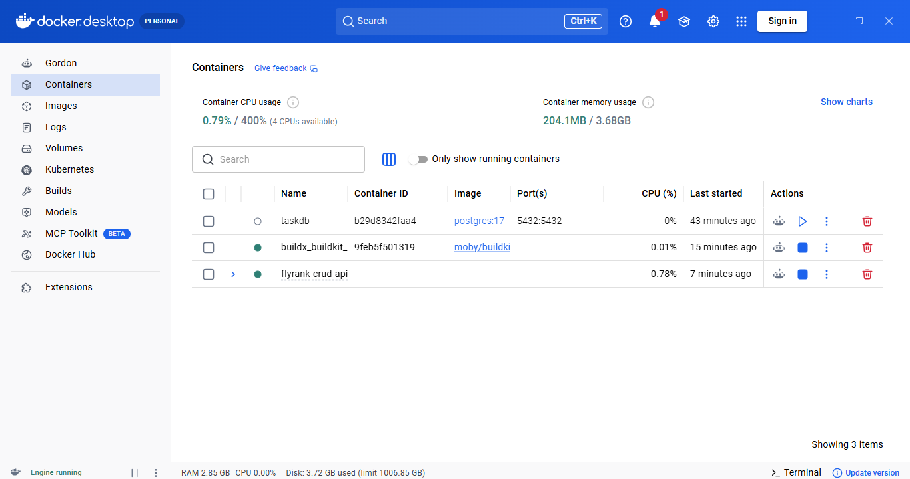
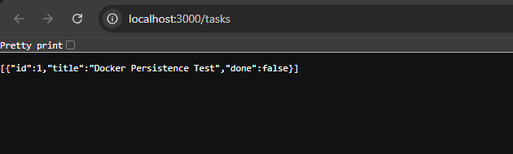

# FlyRank CRUD API

A RESTful CRUD API with authentication, built using Node.js, Express, PostgreSQL, and Supabase. Containerized using Docker and Docker Compose. Developed as part of the FlyRank Backend AI Engineering internship.

## Features

- Create, view, update, and delete tasks.
- Input validation and appropriate HTTP status codes.
- PostgreSQL database integration.
- Automatic database table initialization.
- Persistent database storage using Docker volumes.
- Dockerized Node.js application.
- Docker Compose orchestration.
- Supabase authentication integration.
- User signup and login.
- JWT-based authentication and token verification.
- Protected API routes using reusable Express middleware.
- User logout functionality.
- Interactive Swagger API documentation with Bearer authentication.

## Technologies Used

- Node.js
- Express.js
- PostgreSQL
- Supabase Authentication
- JavaScript
- `pg` (node-postgres)
- Docker
- Docker Compose
- Swagger UI
- `@supabase/supabase-js`

## Prerequisites

- Node.js
- Docker Desktop with Docker Compose
- Git
- Supabase account and project

## Installation and Setup

1. Clone the repository:

   ```bash
   git clone https://github.com/harz0/flyrank-crud-api.git
   ```

2. Navigate to the project directory:

   ```bash
   cd flyrank-crud-api
   ```

3. Create your environment file:

   ```powershell
   Copy-Item .env.example .env
   ```

4. Configure the environment variables in `.env`:

   - PostgreSQL password
   - Database connection URL
   - Server port
   - Supabase project URL
   - Supabase publishable key

5. Build and start the application:

   ```bash
   docker compose up --build -d
   ```

6. Check the container status:

   ```bash
   docker compose ps
   ```

The API runs at:

http://localhost:3000/

## API Endpoints

### General Endpoints

| Method | Endpoint | Description |
|---|---|---|
| GET | `/` | Check if the API is running |
| GET | `/health` | Check API health |

### Task Management Endpoints

| Method | Endpoint | Description |
|---|---|---|
| GET | `/tasks` | Get all tasks |
| GET | `/tasks/:id` | Get a task by ID |
| POST | `/tasks` | Create a new task |
| PUT | `/tasks/:id` | Update a task |
| DELETE | `/tasks/:id` | Delete a task |

### Authentication Endpoints

| Method | Endpoint | Description |
|---|---|---|
| POST | `/auth/signup` | Register a new user |
| POST | `/auth/login` | Login an existing user |
| POST | `/auth/logout` | Logout an authenticated user |

### Protected Endpoints

These endpoints require a valid JWT access token in the Authorization header.

| Method | Endpoint | Description |
|---|---|---|
| GET | `/protected/profile` | Retrieve authenticated user profile |
| GET | `/protected/dashboard` | Access the protected dashboard |

## Authentication Workflow

Supabase Authentication is used to manage user registration and login.

1. A user registers through `/auth/signup` using an email and password.
2. The user logs in through `/auth/login`.
3. Supabase returns an access token and refresh token.
4. The client sends the access token with protected API requests.
5. Express authentication middleware extracts and verifies the JWT using Supabase.
6. If the token is valid, the request proceeds to the protected route.
7. If the token is missing or invalid, the API returns HTTP 401 Unauthorized.

### Bearer Token Authorization

Protected requests must include:

```http
Authorization: Bearer YOUR_ACCESS_TOKEN
```

The reusable authentication middleware verifies the token and attaches the authenticated user to the request object.

## Database

PostgreSQL is used to store task information.

- **Database:** `tasks`
- **Table:** `tasks`
- **Columns:** `id`, `title`, `done`
- **Initialization script:** `db/init.sql`
- **Persistent volume:** `taskdata`

The database table is initialized automatically when the application starts. Docker Compose uses a named volume to preserve database data when containers are recreated.

## Environment Configuration

Create a local `.env` file using `.env.example`.

| Variable | Description |
|---|---|
| `POSTGRES_PASSWORD` | PostgreSQL password |
| `DATABASE_URL` | PostgreSQL connection string |
| `PORT` | API server port |
| `SUPABASE_URL` | Supabase project URL |
| `SUPABASE_KEY` | Supabase publishable key |

The `.env` file is excluded from Git. Never commit private credentials or secret keys.

## Swagger Documentation

Explore and test the API interactively at:

**http://localhost:3000/docs**

The Swagger interface documents the CRUD and authentication endpoints.

It also supports Bearer JWT authorization for testing protected routes.

To test protected endpoints:

1. Execute `/auth/login`.
2. Copy the returned `access_token`.
3. Click the Swagger **Authorize** button.
4. Paste the access token into the Bearer authentication field.
5. Execute `/protected/profile` or `/protected/dashboard`.

## Verify Data Persistence

1. Create a task using the API.
2. Stop and remove the containers:

   ```bash
   docker compose down
   ```

3. Start the containers again:

   ```bash
   docker compose up -d
   ```

4. Retrieve the tasks:

   ```powershell
   Invoke-RestMethod -Uri "http://localhost:3000/tasks" -Method Get
   ```

Previously stored tasks should still be present because the named PostgreSQL volume persists independently of the containers.

**Important:** Do not use `docker compose down -v` when testing persistence, because that command removes the Compose-managed volume.

## Example Requests

Retrieve all tasks:

```bash
curl http://localhost:3000/tasks
```

Create a task using PowerShell:

```powershell
Invoke-RestMethod -Uri "http://localhost:3000/tasks" -Method Post -ContentType "application/json" -Body '{"title":"Sample Task","done":false}'
```

## Screenshots

### Swagger UI


### Database



### Docker Desktop



### PostgreSQL API Response



## Stopping the Application

```bash
docker compose down
```

The named database volume is retained unless explicitly removed.

## Repository

GitHub: https://github.com/harz0/flyrank-crud-api

Developed as part of the FlyRank Backend AI Engineering Internship.