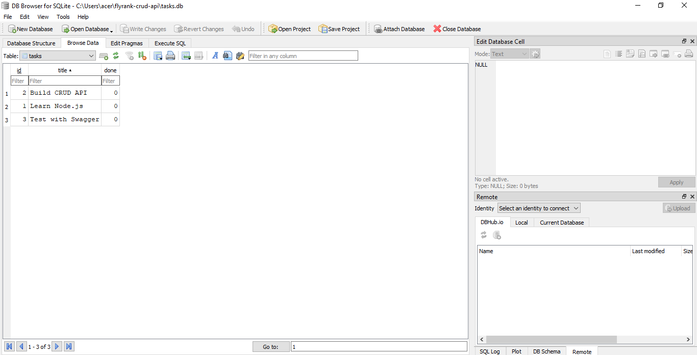
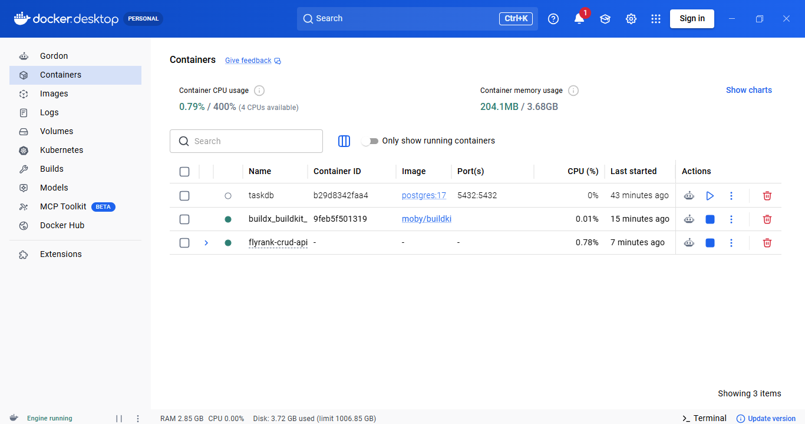
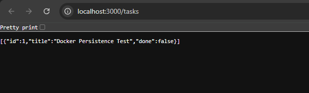

# FlyRank CRUD API

A RESTful CRUD API built with Node.js, Express, and PostgreSQL, containerized using Docker and Docker Compose. Developed as part of the FlyRank Backend AI Engineering internship.

## Features

- Create, view, update, and delete tasks
- Input validation and appropriate HTTP status codes
- PostgreSQL database integration
- Automatic database table initialization
- Persistent database storage using Docker volumes
- Environment-based configuration
- Dockerized Node.js application
- Docker Compose orchestration
- Swagger API documentation

## Technologies Used

- Node.js
- Express.js
- PostgreSQL
- `pg` (node-postgres)
- Docker
- Docker Compose
- Swagger UI

## Prerequisites

- Docker Desktop with Docker Compose
- Git

## Installation and Setup

1. Clone the repository:

   ```bash
   git clone https://github.com/harz0/flyrank-crud-api.git
   ```

2. Navigate to the project directory:

   ```bash
   cd flyrank-crud-api
   ```

3. Create your environment file by copying the example:

   ```powershell
   Copy-Item .env.example .env
   ```

4. Build and start the application and PostgreSQL database:

   ```bash
   docker compose up --build -d
   ```

5. Check the container status:

   ```bash
   docker compose ps
   ```

The API runs at:

http://localhost:3000/

## API Endpoints

| Method | Endpoint | Description |
|---|---|---|
| GET | `/` | Check if the API is running |
| GET | `/health` | Check API health |
| GET | `/tasks` | Get all tasks |
| GET | `/tasks/:id` | Get a task by ID |
| POST | `/tasks` | Create a new task |
| PUT | `/tasks/:id` | Update a task |
| DELETE | `/tasks/:id` | Delete a task |

## Database

PostgreSQL is used to store tasks.

- **Database:** `tasks`
- **Table:** `tasks`
- **Columns:** `id`, `title`, `done`
- **Initialization script:** `db/init.sql`
- **Persistent volume:** `taskdata`

The database table is initialized automatically when the application starts. Docker Compose uses a named volume to preserve database data when containers are recreated.

## Environment Configuration

Create a local `.env` file using `.env.example`.

- `POSTGRES_PASSWORD`: PostgreSQL password used by Docker Compose.
- `DATABASE_URL`: PostgreSQL connection string for local execution.
- `PORT`: API server port.

The `.env` file is excluded from Git. Do not commit real credentials.

## Verify Data Persistence

1. Create a task using the API.
2. Stop and remove the containers:

   ```bash
   docker compose down
   ```

3. Start the containers again:

   ```bash
   docker compose up -d
   ```

4. Retrieve the tasks:

   ```powershell
   Invoke-RestMethod -Uri "http://localhost:3000/tasks" -Method Get
   ```

Previously stored tasks should still be present because the named PostgreSQL volume persists independently of the containers.

**Important:** Do not use `docker compose down -v` when testing persistence, because that command removes the Compose-managed volume.

## Swagger Documentation

Explore and test the API interactively at:

http://localhost:3000/api-docs/

## Example Request

Retrieve all tasks:

```bash
curl http://localhost:3000/tasks
```

Create a task using PowerShell:

```powershell
Invoke-RestMethod -Uri "http://localhost:3000/tasks" -Method Post -ContentType "application/json" -Body '{"title":"Sample Task","done":false}'
```

## Swagger UI Screenshot


## Database Screenshot



## Stopping the Application

```bash
docker compose down
```

The named database volume is retained unless explicitly removed.
## Docker Desktop Screenshot



## PostgreSQL API Response

